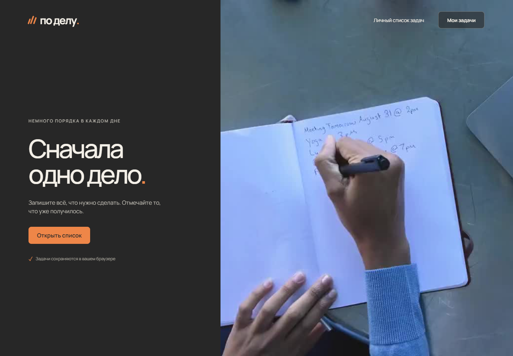
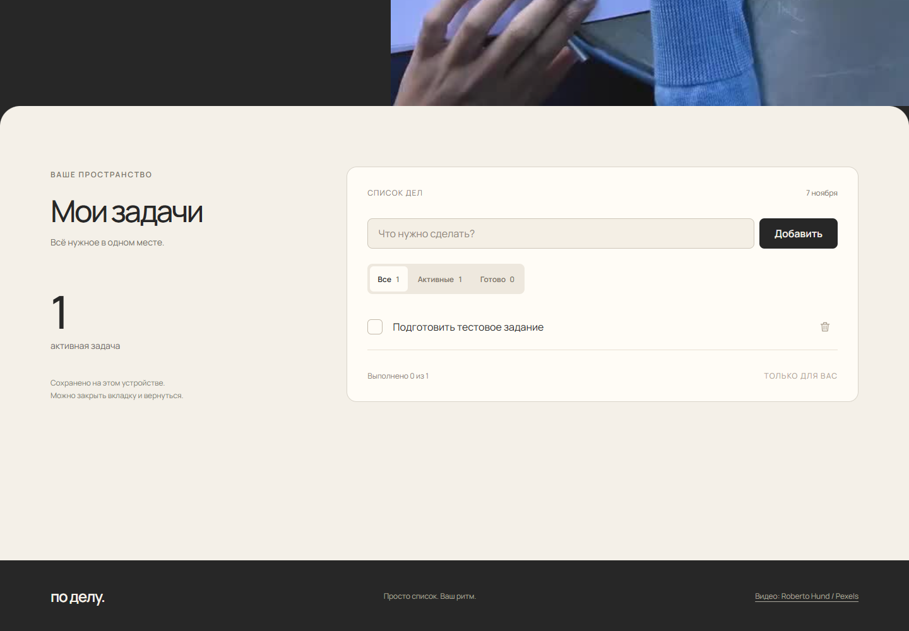

# По делу

Простой список задач на HTML, CSS и JavaScript. Можно добавить дело, отметить его выполненным, удалить и вернуться к списку после обновления страницы.

**[Открыть сайт](https://po-delu-todo.vercel.app/)** · **[Отчёт с примером работы](REPORT.md)** · **[Сообщение для отправки](SUBMISSION.md)**



## Что реализовано

| Требование | Реализация |
| --- | --- |
| Добавление | Поле ввода, кнопка «Добавить» и клавиша Enter |
| Выполнение | Чекбокс, зачёркивание текста и обновление счётчиков |
| Удаление | Кнопка рядом с каждой задачей |
| Сохранение после обновления | Автоматическая запись списка в localStorage |

Дополнительно: фильтры «Все», «Активные», «Готово», очистка выполненных, отмена удаления и синхронизация между вкладками одного браузера.

Интерфейс адаптирован для телефона и компьютера. Видео с планированием дня движется вместе с прокруткой. К списку можно сразу перейти кнопкой «Мои задачи». При включённой настройке уменьшения движения остаётся постер.

## Пример использования

1. Откройте сайт и нажмите «Мои задачи».
2. Введите **Подготовить тестовое задание** и нажмите «Добавить» или Enter.
3. Обновите страницу: задача останется в списке.
4. Отметьте её чекбоксом: текст будет зачёркнут, счётчик выполненных увеличится.
5. Обновите страницу ещё раз: отметка сохранится.
6. Удалите задачу кнопкой рядом с ней. При случайном удалении можно нажать «Вернуть».



Сценарий проверен на публичном сайте. Скриншоты выполнения и мобильной версии находятся в [отчёте](REPORT.md).

## Структура проекта

```text
index.html             Разметка страницы
styles.css             Стили списка и адаптивность
hero-refresh.css       Компоновка первого экрана
app.js                 Интерфейс, сохранение и видео
store.js               Создание и проверка данных задач
assets/                Видео, постер и шрифты
build.mjs              Подготовка публичных файлов в dist
server.mjs             Локальный сервер
tests/                 Модульные и браузерные проверки
docs/screenshots/      Скриншоты опубликованного сайта
vercel.json            Настройки публикации
```

Для такой задачи достаточно обычного JavaScript. Приложение не требует серверной базы данных или регистрации. Список хранится в браузере на конкретном устройстве; в другом браузере будет отдельный список. Очистка данных сайта удаляет записи. При недоступном хранилище показывается сообщение, работа продолжается в текущей вкладке.

## Запуск локально

Нужен Node.js 20 или новее. Зависимостей для работы сайта нет.

```sh
git clone https://github.com/blad3r81/po-delu-todo.git
cd po-delu-todo
node server.mjs
```

Откройте http://localhost:4174. Для JS-модулей и загрузки видео нужен HTTP-сервер, открытие через file:// не подходит.

Сборка: `node build.mjs`. В папку `dist` копируются только публичные файлы. Настройки Vercel уже заданы в `vercel.json`, переменные окружения для сайта не нужны. Репозиторий подключён к проекту Vercel.

## Проверки

Модульные тесты:

```sh
node --test tests/store.test.mjs
```

Для браузерных тестов нужен Playwright:

```sh
npm install --no-save playwright
npx playwright install chromium
# Сервер должен быть запущен в отдельном терминале
node tests/browser.mjs
# Проверка публичного сайта и создание скриншотов отчёта
node tests/production.mjs
```

`BASE_URL` задаёт другой адрес. По умолчанию browser.mjs проверяет localhost, production.mjs — публичный сайт. Можно задать `BROWSER_PATH` для установленного Edge/Chromium и `PLAYWRIGHT_MODULE` для уже установленного Playwright.

Проверены основные действия, сохранение после обновления, фильтры, отмена удаления, две вкладки, длинные названия и ширины 320/390/768/1440 px. Результаты — в [REPORT.md](REPORT.md).

## Использование AI

Использовал **Codex от OpenAI** для написания кода, работы над интерфейсом и подготовки проверок. Через него выполнялись правки по требованиям, браузерные тесты и публикация проекта. Видео взято из фотобанка, оно не сгенерировано AI.

Стек: HTML, CSS, JavaScript ES Modules, localStorage. Проверки: Node.js test runner и Playwright. Код опубликован на GitHub, сайт — на Vercel.

## Материалы

- Видео: [A Person Writing Her Daily Schedule — Roberto Hund / Pexels](https://www.pexels.com/video/a-person-writing-her-daily-schedule-5354517/), [лицензия Pexels](https://www.pexels.com/license/). Локальная копия без звука подготовлена для поиска кадров при прокрутке.
- Шрифт: [Manrope](https://fonts.google.com/specimen/Manrope), SIL Open Font License. Файлы и лицензия находятся в assets.

