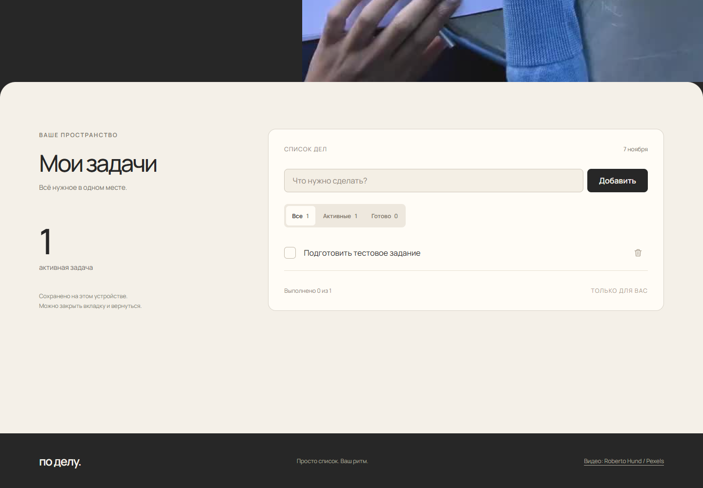
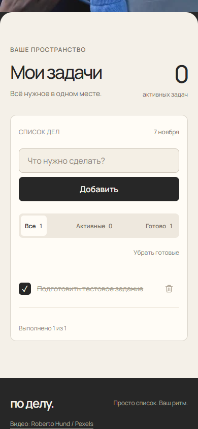

# Отчёт по тестовому заданию

**Проект:** «По делу», список задач.  
**Сайт:** https://po-delu-todo.vercel.app/  
**Репозиторий:** https://github.com/blad3r81/po-delu-todo  
**Дата проверки:** 7 ноября 2026 года.

## Задача и результат

Нужно было сделать сайт с четырьмя функциями: добавлять задачи, отмечать выполнение, удалять записи и сохранять список после обновления страницы.

Все четыре функции реализованы и проверены на опубликованном сайте. Приложение открывается без регистрации. Новому посетителю показывается пустой список с предложением добавить первое дело.

## Что было сделано

1. Собрана страница с первым экраном и рабочим списком. Выбраны графитовый фон, светлая поверхность списка и оранжевый акцент. У кнопок нет декоративных стрелок и свечения, фон без градиентов.
2. Написана логика добавления, выполнения и удаления. Добавлены фильтры, счётчики и отмена удаления.
3. Настроено сохранение в localStorage. После каждого изменения записывается актуальный список, при открытии страницы он восстанавливается.
4. Подготовлено видео с записью плана дня. Кадр зависит от прокрутки, к списку можно перейти отдельной кнопкой.
5. Проверены основные сценарии и мобильная раскладка. Код отправлен в GitHub, сайт опубликован в Vercel и повторно проверен по публичному адресу.

## Пример: «Подготовить тестовое задание»

Сценарий выполнен в отдельном тестовом браузере на публичном сайте.

### Добавление

В поле введено название задачи и нажата клавиша Enter. В списке появилась одна активная задача, счётчики изменились на «Все 1», «Активные 1», «Готово 0». После обновления страницы запись сохранилась.

### Выполнение

После нажатия на чекбокс текст зачёркнут, активных задач стало 0, выполненных — 1. Страница обновлена повторно: задача осталась выполненной.

### Удаление

Нажата кнопка удаления рядом с задачей. После обновления страницы список остался пустым. Отдельной проверкой подтверждено, что кнопка «Вернуть» восстанавливает удалённую задачу, пока показано уведомление.

Тестовая запись не добавляется всем посетителям: каждый браузер хранит свой список.

## Что происходит в коде

При отправке формы из названия убираются пробелы по краям. Пустая строка не становится задачей. Для новой записи создаются уникальный id, текст и признак done: false.

Запись добавляется в массив, массив сохраняется в localStorage, интерфейс обновляется. Чекбокс меняет done, кнопка удаления убирает запись из массива. Эти действия тоже сразу сохраняются.

После перезагрузки приложение читает сохранённые данные, проверяет их структуру и восстанавливает список. Название выводится через textContent, поэтому введённый HTML отображается как обычный текст. Длинные названия переносятся внутри строки задачи.

## Проверки

| Проверка | Результат |
| --- | --- |
| Добавление кнопкой и Enter | Пройдено |
| Только пробелы в поле | Задача не создаётся, выводится подсказка |
| Отметка выполнения | Состояние и счётчики меняются |
| Обновление страницы | Сохраняются текст и отметка выполнения |
| Удаление и повторное обновление | Запись не появляется снова |
| Отмена удаления | Задача восстанавливается |
| Фильтры и очистка выполненных | Пройдено |
| Две вкладки | Изменения синхронизируются |
| HTML в названии | Отображается текстом, не выполняется |
| Ширины 320, 390, 768 и 1440 px | Горизонтальное переполнение не обнаружено |
| Видео и reduced motion | Видео связано с прокруткой, при reduced motion остаётся постер |
| Публичный адрес без авторизации | HTTP 200, открывается приложение |
| Ошибки JavaScript в проверенных сценариях | Не обнаружены |

Дополнительно пройдены четыре модульных теста для ввода, сериализации, проверки данных и склонения слова «задача». Исходники проверок находятся в tests.

### Мобильная версия

## Инструменты и ограничения

Для разработки использован **Codex от OpenAI**. Через него написаны HTML, CSS и JavaScript, подготовлены тесты и выполнены правки интерфейса. Проверки выполнялись через Node.js test runner и Playwright в Edge/Chromium. Публикация выполнена через Git и Vercel CLI. Визуальные материалы: видео Pexels и шрифт Manrope с открытой лицензией.

Серверной базы данных и аккаунтов пользователей нет: для задания данные хранятся локально. Список не переносится между устройствами, очистка данных браузера удаляет записи. Видео работает независимо от списка: если его загрузка не удастся, останется постер, а задачи продолжат работать.

